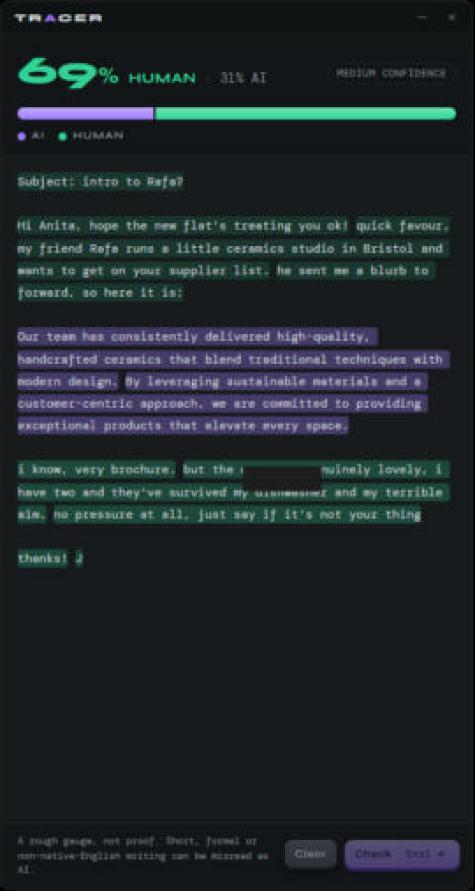
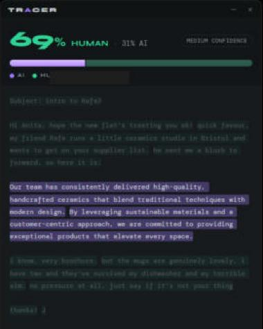

# Phase 2: App shell and UI report

*2026-11-04 · Tauri 2 + React 19 · verified in the running dev app on Windows 11*

## What works (seen in the real app, not just built)

- **Paste → result:** pasting runs the analysis straight away. `Ctrl+Enter` re-checks, `Esc` clears.
  Pasting while a result is showing replaces the text and re-checks.
- **Result header:** the larger share is shown big ("**69%** HUMAN · 31% AI") in its side's colour, next to the confidence badge.
- **Split bar:** AI segment (violet) on the left, Human (green) on the right, with a legend in the same order.
- **Highlighted text:** each sentence is tinted in its bar colour, as strong as the score is decisive, so 0.95 is strong, 0.6 faint and ~0.5 almost clear. Code blocks and URLs show in muted grey and aren't scored.
- **Hover:** a sentence shows "87% likely AI" or "92% likely human", capped at 99% because it's a gauge, not proof. Hovering a bar segment or legend key dims the other side's sentences (second screenshot below).
- **States:**
  - Empty: an explainer plus the `Ctrl+Shift+H` hint.
  - Too short: "Too short to judge" and "Paste at least a few sentences."
  - Weak signal: the result is greyed out with the short-text notice.
  - Notices for non-English and truncated text.
  - Model loading or missing: a message in the footer, and a paste made while the model loads runs once it's ready.
  - Shimmer on the bar if analysis takes longer than 300 ms.
  - Edited text dims the old result until it's re-checked.
- **Trace-in:** the bar fills left to right behind a glowing head (~420 ms), and the sentence tints fade in along the same sweep. Disabled under reduced-motion.
- **Click the highlighted text** to edit it. Selecting text doesn't flip into edit mode.
- **Always-visible footnote:** "A rough gauge, not proof. Short, formal or non-native-English writing can be misread as AI."

## Your calls this phase

| Decision | Result |
|---|---|
| Design base | **Vixer's current code**: Syne + DM Mono (bundled locally), `#181b1f` surfaces, Vixer's title bar and rubber buttons. Human = Vixer's Talk green `#34d399`. AI = Tracer violet `#a27bff`. The wordmark is "Tr**a**cer" with a violet *a*, echoing Vixer's amber *x*. |
| Window size | **470 × 888**: 20% wider and twice the height of Vixer's 392 × 444. |
| Height resize | A **6 px grip along the bottom edge** (↕ cursor) drags the height. Minimum 480. **Width is locked at 470.** Say if you want it adjustable too. |

**Added safeguard:** if the screen's work area is shorter than 888 px (e.g. 1366×768, or
1080p at 150%), the window is shortened to fit on launch. Otherwise its bottom edge and
resize grip would be off-screen.

## Contrast (WCAG AA, both themes)

`node tools/contrast-check.mjs` checks every text colour against its surface, plus body text on the
strongest highlight tints:

- **Body text on tints:** dark 6.6:1 on AI and 5.4:1 on Human; light 11.4:1 and 12.6:1.
- **Changes needed to pass:** Vixer's hint grey `#43474f` fails on its own background, so Tracer uses `#6c707a`. The light theme also needed a darker amber for notices.

## How the work was split

- **Sonnet subagent:** scaffolded the Tauri app from Vixer's setup (configs, `src-tauri`, engine wiring, typed IPC). I reviewed it and changed two things:
  - The model-ready event could be missed, leaving the UI stuck on "loading". It now subscribes before fetching the status.
  - The window is shown from Rust at startup, as Vixer does, with a dark `backgroundColor` so there's no white flash. It was previously left to the frontend and stayed hidden in testing.
- **Opus:** the design tokens, result bar, highlighted text, trace-in animation, states and keyboard handling.

## Not done yet / not verified

- **Light theme:** tokens are defined and contrast-checked, but there's no switch until Settings (Phase 3). I haven't looked at it in the app.
- **`Ctrl+Shift+H`:** the hint is shown but the hotkey isn't wired up until Phase 3. Same for the tray and close-to-tray; close currently quits.
- **Trace-in animation:** checked in code and the CSS, but not frame by frame on screen. It lasts about 0.4 s.
- **Model download:** missing-model handling is a footer message until Phase 3's first-run download screen.

## Next: Phase 3

Hotkey, tray, settings (hotkey, launch at startup, theme, model info) and the first-run model download from the `model-v1` GitHub release.
Most of this is porting Vixer's existing code, so it goes to a **Sonnet session**. Opus keeps the download/SHA-256 flow and the RAM-unload decision.
