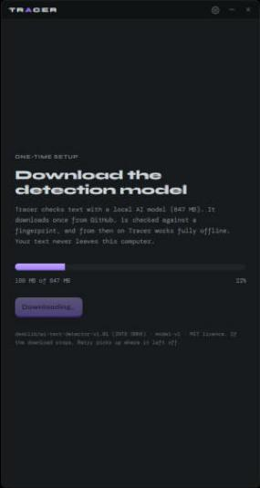
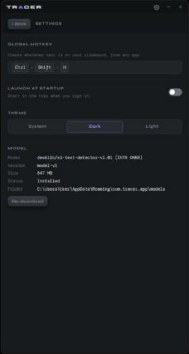
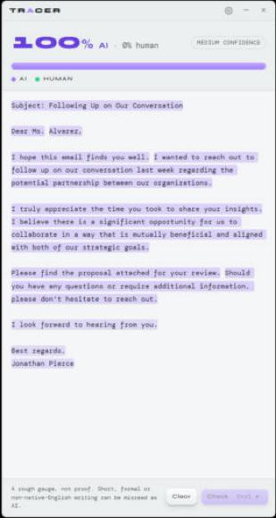

# Phase 3: Hotkey, tray, settings, model download

*2026-11-04 · verified in the running dev app from a clean first run*

## Your calls this phase

| Decision | Result |
|---|---|
| Model hosting | `garethllew/tracerapp` is now **public**; the model is the [`model-v1` release](https://github.com/garethllew/tracerapp/releases/tag/model-v1) (`tracer-int8.onnx` 838 MB + `tokenizer.json`, MIT notices, SHA-256s in the notes). Anonymous download returns 200, Range requests return 206, and the hash matches the pin. |
| Memory | **Not loaded at startup. Loads on the first check, stays for 1 minute after the last check, then unloads. The next check reloads it.** One constant (`HOLD` in `src-tauri/src/engine.rs`). |

## Verified in the app

| What | Result |
|---|---|
| First run (no model) | Setup screen → **Download model** → 847 MB from GitHub in **26 s**, SHA-256 verified, then the main window |
| First check | Model loaded on demand in **1.3 s**, 113 words analysed in 350 ms |
| RAM | **47 MB** before any check → **~1,000 MB** while held → **69–75 MB** after the unload |
| Unload | Logged "model unloaded after 60 s without a check" 62 s after the check (the timer checks every 5 s) |
| Close (×) | Window hides; process keeps running in the tray |
| `Ctrl+Shift+H` with the window hidden | Reads the clipboard, shows the window, analyses: the AI email reads 100% AI |
| Hotkey after an unload | Reloads in **1.24 s** and analyses (this caught a real bug, below) |
| Settings | Opens from the cog; hotkey field, startup toggle, theme switch, model info and Re-download all render |
| Light theme | Switches live and stays readable (screenshot below). Back to Dark now. |
| Saved settings | `settings.json` holds only `hotkey`, `launchAtStartup` and `theme`. **No text is ever saved.** |

  

## Bug found and fixed

**Reloading the model failed after the first unload:** "only one environment is allowed per process".
ONNX Runtime allows exactly one runtime environment per process and remembers it even after
it's dropped. The engine now creates the environment once and keeps it; it's small, and the model memory
is still freed on unload. A real-model regression test (`load_drop_load_again`) covers it.

## How it was built

- **Sonnet subagent**, porting from Vixer: settings stored with `tauri-plugin-store`, the global hotkey (clipboard read in Rust, never exposed to the webview), the tray (Open / Check clipboard / Settings / Quit; left-click toggles the window), close-to-tray, autostart (launched hidden with `--startup`), the Settings panel, and the theme switch. No new webview permissions were needed.
- **Opus:**
  - `download.rs`: resumable, SHA-256-pinned download. Unlike Vixer, an interrupted transfer keeps its `.part` file and Retry resumes with an HTTP Range request. A size or checksum mismatch discards the partial file. 7 tests cover it against a local HTTP server: resume, a server ignoring Range, checksum mismatch, an oversized response.
  - `engine.rs`: the load-on-check / 1-minute-unload lifecycle, with no double-loads and no unloading mid-check.
  - The setup screen, the Settings → Model section, the release, and the integration.

## Not verified (needs you, or the screen)

- **Tray icon clicks and the tray menu** (Open / Check clipboard / Settings / **Quit**): the taskbar belongs to Windows Explorer, which I can't control. The code paths are shared with the hotkey and the cog, which were tested.
- **Launch at startup:** my attempt to toggle it was blocked as a persistence change (it writes a login entry for your account). Please try the toggle yourself.
- **Recording a new hotkey** in Settings, including the "taken by another app" error.
- **Interrupting a real download:** resume is tested against a local server, not by pulling the network cable mid-download.
- **Theme flash:** light-theme users may see a brief dark flash at launch before the setting loads.

## Notes

- The model you just downloaded lives in `%APPDATA%\com.tracer.app\models`. The installed app will use the same folder.
- Dev builds also look in `tools/model-export/work/onnx`. Set `TRACER_NO_DEV_MODEL=1` to test the first-run download.

## Next: Phase 4 (packaging)

Icon options (2–3 SVGs, a streak/trail motif in the Vixer shape language), Azure Trusted Signing, a GitHub Releases workflow, a winget manifest, and the Tauri updater if you want it (Vixer's setup decides).
