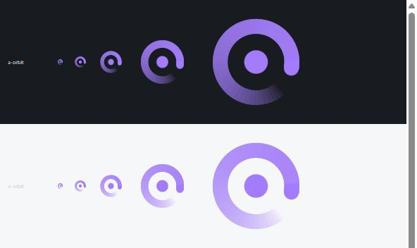

# Phase 4: Packaging report

*2026-11-04 · `npm run tauri build` verified locally · workflows not yet run on GitHub*

## The brief vs Vixer

The brief says to "mirror Vixer's pipeline: GitHub Releases, Azure Trusted Signing, winget, Tauri updater if Vixer uses it".
**Vixer has none of these.** It's built by hand (`npm run tauri build`), ships unsigned (its PACKAGING.md
walks friends through *More info → Run anyway*), and has no CI, updater or winget manifest. So Tracer's pipeline is
new, built to the brief:

- **No Tauri updater:** the brief makes it conditional on Vixer, and Vixer doesn't have one.
- **Signing is ready but switched off:** it turns itself on once you configure Azure.

## Icon: A · Orbit, closed to 320° (your pick)

Vixer's construction: a thick round-capped open ring with a solid dot, flat colour, no background. In Tracer violet, the ring
is a 320° trail that fades in toward its head, like the glowing trail of a tracer round.

- **Source:** `design/icons/tracer-icon-a-orbit.svg`, generated by `tools/icons/make-icons.mjs`.
- **Fade technique:** the fade is 40 stacked translucent arcs. SVG has no conic gradient, and abutting segments showed seams.
- **App icons:** every app icon size (`.ico`, tray PNG, …) is generated from that SVG by `npx tauri icon`.
- **Other options:** B (Pair) and C (Streak) are kept in `design/icons/` for reference.

## Installer

| File | Size |
|---|---|
| `Tracer_0.1.0_x64-setup.exe` (NSIS, per-user, no admin prompt) | **8.86 MiB** |
| `Tracer_0.1.0_x64_en-US.msi` | 21.84 MiB |

The model (847 MB) is not in the installer; it downloads on first run (Phase 3).

### DirectML: kept out of the installer

The prebuilt ONNX Runtime that `ort` downloads is *always* compiled with Microsoft's DirectML GPU provider on
Windows, so `tracer.exe` imports `DirectML.dll`. The packaging agent's first fix was to ship the 18.5 MB DLL, which
doubled the installer to 17.3 MiB and would have needed a Microsoft redistribution notice.

Instead, `src-tauri/build.rs` **delay-loads** it, so Windows only loads the DLL if a DirectML function is called.
Tracer only uses the CPU, so that never happens. **Verified:** with no `DirectML.dll` next to the release exe,
a hotkey check analysed 356 words in 1.23 s, and `DirectML.dll` never appeared in the process's loaded modules.

## Pipeline (`.github/workflows/`)

- **`ci.yml`:** on every push/PR to `main`, type-check, front-end build, and both Rust test suites.
- **`release.yml`:** runs on a `vX.Y.Z` tag:
  1. Fails if the tag doesn't match the version in `package.json`, `tauri.conf.json` and `Cargo.toml`.
  2. Runs the tests.
  3. Builds, signed only if Azure is configured (see below).
  4. Writes `SHA256SUMS.txt`.
  5. Creates a **draft** GitHub release with the exe, msi and checksums. You review and publish it.
- **Signing (Azure Artifact Signing, formerly Trusted Signing):**
  - Uses `artifact-signing-cli` via Tauri's `signCommand`, per the [Tauri docs](https://v2.tauri.app/distribute/sign/windows/). The `trusted-signing-cli` named in my brief to the agent is deprecated.
  - Switches on only when all six Azure secrets/variables are set, and then fails the build unless every file's signature is `Valid`.
  - Without them, builds are unsigned and the job summary says so.
  - **Setting up the Azure account is yours to do** (monthly fee, identity validation). PACKAGING.md walks through it.

## winget (`packaging/winget/`)

- **Manifests:** multi-file manifests (schema 1.28.0) for `RotationStudio.Tracer`, per-user NSIS install.
- **Update script:** `update-manifest.ps1 -Version x.y.z` fills in the installer URL and SHA-256 from a published release.
- **Validation:** `winget validate` passed against a local build.
- **Submitting** to microsoft/winget-pkgs is a manual step for you (`wingetcreate submit`, documented).

## Docs

`PACKAGING.md`, in the same friendly style as Vixer's, covers:
- local builds;
- cutting a release;
- enabling signing;
- winget;
- **publishing a new model** (re-export, upload `model-vN`, re-pin the SHA-256s in `download.rs`).

## Assumptions to confirm

- **Publisher "Rotation Studio"** and the winget ID **`RotationStudio.Tracer`**. Changing the winget ID after the first submission makes winget treat Tracer as a new package. PACKAGING.md → "The publisher name" lists every place to edit.

## Not verified

- **The workflows haven't run on GitHub.** The YAML parses. CI will run on the next push to `main`, and the release workflow on the first `v0.1.0` tag.
- **The signed path** (needs your Azure setup).
- **The installers themselves:** I didn't run them on this machine. The release exe was run directly.
- **The new icon in the taskbar and tray:** screen access was declined for that check.
